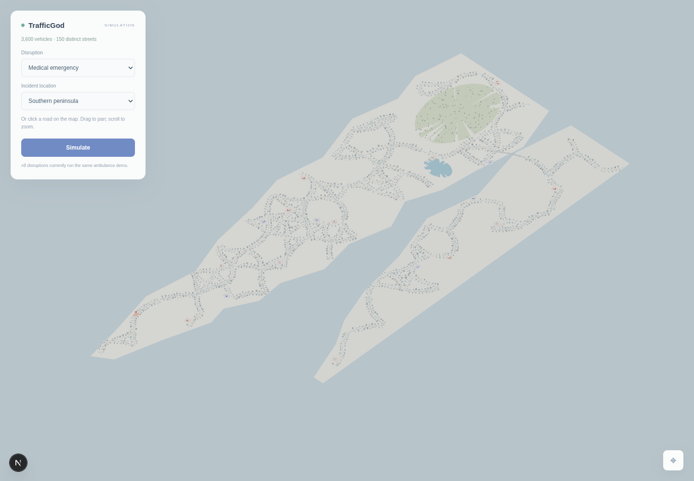

# TrafficGOD

**Autonomous urban emergency response digital twin — low-poly emergency traffic simulation.**

TrafficGOD aims to simulate a city where users inject emergencies and disruptions anywhere on a road network. The controller would then coordinate responder routes, traffic signals, and civilian traffic while measuring the effect on both emergency response and the wider city.

> **Status:** Runnable Next.js / Three.js simulation demo. The frontend shows a compact Mumbai-inspired coastal city and disruption controls. Every disruption selection currently runs a scripted ambulance round trip with signal preemption and civilian yielding. The city is procedural, not an exact Mumbai road map; SUMO integration and trained RL policies remain planned.

## The flagship challenge

A fire occurs on any road in a network of 1,000+ roads. Can the system dispatch responders, clear and maintain a priority corridor before they arrive, and prevent secondary congestion elsewhere?

The central idea is **anticipatory corridor clearing**: predict when a responder will reach each intersection, move vehicles already in its path, coordinate green phases ahead of it, then return signals to normal after it passes.

## Planned experience

1. Select an event such as a fire, ambulance call, accident, road closure, signal failure, flood, or heavy congestion, and place it on the map.
2. Watch dispatch, route selection, signal changes, traffic diversion, and corridor recovery in the simulation.
3. Compare the controller against fixed timing, actuated control, and max pressure baselines using the same scenario and demand.
4. Inspect responder ETA, stops, citywide delay, queue spillback, and recovery time. Future challenge modes may include simultaneous incidents and human versus AI control.

## Proposed system

```text
User event -> event manager -> city state -> routing and signal controller
                                      -> SUMO/TraCI -> map and metrics
```

- **Simulation:** [SUMO](https://sumo.dlr.de/) for vehicle traffic, signal control, and emergency vehicles; [TraCI](https://sumo.dlr.de/docs/TraCI.html) for live control.
- **Networks:** Import bounded areas from [OpenStreetMap](https://www.openstreetmap.org/) and begin with synthetic demand. Keep scenarios reproducible through fixed seeds and recorded event definitions.
- **Control:** Implement simple, measurable baselines first. Explore cooperative multi-agent reinforcement learning once the simulation and evaluation pipeline are reliable.
- **Routing:** Select feasible responder routes, account for blocked lanes and roads, and coordinate signal preemption with upstream diversion.
- **Interface:** A live map for incident placement, responder progress, signal state, congestion, and side-by-side results.

The controller's priorities depend on the event. For an ambulance, the main measure is a smooth trip from the incident to a hospital. For a fire, it is responder arrival from a station, potentially with multiple vehicles. For a road blockage, it is limiting queue spillback and restoring network flow.

## Research plan

| Stage | Network | Deliverable |
| --- | --- | --- |
| 0 | 9 intersections | Reproducible SUMO scenario, incident injection, and fixed timing baseline |
| 1 | 25 intersections | Emergency routing and corridor clearing with a rule-based controller |
| 2 | 100 intersections | Actuated and max pressure comparisons; consistent evaluation metrics |
| 3 | OSM neighborhood | Map interface, real road topology, and scenario replay |
| 4 | Larger city area | Multi-agent learning experiments and scaling benchmarks |
| 5 | 1,000+ roads | Multi-incident stress tests and generalization to unseen scenarios |

Candidate learning methods include DQN, PPO, MAPPO, QMIX, and graph-based multi-agent control. These are **planned comparisons**, not implemented or validated results. Potential later work includes graph-based congestion forecasts and context-dependent rewards.

## Evaluation principles

- Run each controller on identical networks, traffic demand, incidents, and random seeds.
- Report responder ETA and stops alongside civilian travel time, queue lengths, spillback, and recovery time.
- Test normal traffic, rush hour, single incidents, concurrent incidents, and unseen locations.
- Include training cost and simulation speed when comparing learning methods.
- Label any dashboard numbers as illustrative until produced by reproducible experiments.

## Getting started

The frontend and model library use one package manifest and lockfile, both in the repository root. Node.js 20.9+ is required.

```sh
npm ci
npm run dev
```

Open [localhost:3000](http://localhost:3000). Choose a disruption and location, or click a road, then press **Simulate**. The ambulance leaves a hospital, travels to the incident, waits briefly, and returns to the hospital. Signals ahead give its corridor priority: crossing traffic waits at stop lines while corridor traffic keeps moving. Vehicles stay within their lanes, follow curved junction turns, and wait for space in the exit road before entering an intersection. The view starts zoomed into the dense city. Left-drag or touch-drag to pan freely, scroll or pinch to zoom, and right-drag to rotate. Clicking the map focuses it for arrow-key panning. Dragging or using the arrow keys also stops automatic ambulance following. Use the map control to fit the whole city. Pause, resume, and reset the episode with the panel.

The city now fits inside a 1.38 × 1.52 km footprint, about 89% smaller than the previous map. It has exactly 100 named, curved road segments: 25 one-lane streets, 50 two-lane roads, and 25 four-lane roads. Its 66 junction nodes include 40 signalised intersections, with 1,028 buildings and 18 emergency-service campuses. The six areas are Shivaji Nagar, Tilak Nagar, Dadar, Worli, Chembur, and Wadala. Roads use Marathi names such as Lokmanya Tilak Marg and Jijamata Marg. Every building has a unique name and a street address; click a building to inspect it. Each area has a named hospital, fire station, and police station. A persistent fleet of 5,000 vehicles is distributed by road length and lane capacity, with a majority of two-wheelers, varied cars, and some trucks. All seven disruption choices currently use the same ambulance scenario; other incident-specific behaviors are future work.

    npm test
    npm run build
    npm run export:models

One package manifest and lockfile live in the repository root. The [model library](3d_models/README.md) includes 29 vehicles and 11 reusable building types. The cars have distinct sculpted bodies, cabins, lights, and grilles. JSON assets live in public/models.

The [simulation controller](simulation/README.md) is separate from scene rendering. It provides the seam for adding a trained RL signal policy later. Routing and traffic reactions are deterministic demo logic, not learned control or measured research results.

For a browser smoke check on Linux with Google Chrome installed, run npm run test:browser while the dev server is running. Set CHROME_PATH for another Chromium executable. It checks camera panning and zoom, named building selection, disruption/location controls, a complete round trip, signal recovery, pause/resume, reset, and mobile layout. The same check can target a deployed site using PREVIEW_URL.

The 3D view requires WebGL 2. If graphics cannot start, enable graphics acceleration under Chrome/Edge Settings → System and relaunch the browser. Open embedded previews in a regular browser tab if needed, then use **Retry graphics**. The renderer lets the browser choose its GPU and retries without antialiasing on less capable devices. A lost graphics context pauses the simulation and resumes it after restoration. Run npm run test:graphics to verify unavailable graphics, retry, reduced settings, and context recovery.



## Deployment

Live simulation: [trafficgod.vercel.app](https://trafficgod.vercel.app).

Vercel configuration is in [vercel.json](vercel.json). Deploy from the repository root with the Vercel CLI:

    vercel deploy --prod --yes

Local Vercel linking data and environment files are excluded from Git and deployment uploads.

## References

- [SUMO documentation](https://sumo.dlr.de/docs/)
- [Importing OpenStreetMap data into SUMO](https://sumo.dlr.de/docs/Networks/Import/OpenStreetMap.html)
- [CityFlow](https://github.com/cityflow-project/CityFlow), a possible later benchmark for large-scale traffic signal control

## License

No license has been selected yet. Until one is added, this repository does not grant a general license to reuse its contents.
