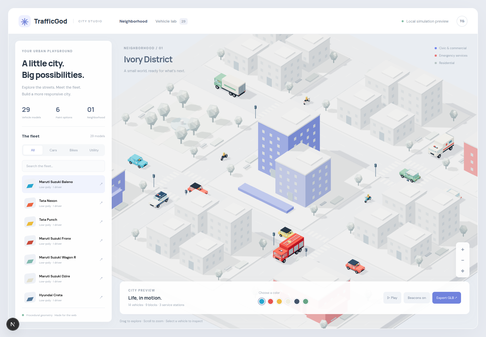

# TrafficGOD

**Autonomous urban emergency response digital twin — low-poly city and fleet preview.**

TrafficGOD aims to simulate a city where users inject emergencies and disruptions anywhere on a road network. The controller would then coordinate responder routes, traffic signals, and civilian traffic while measuring the effect on both emergency response and the wider city.

> **Status:** Runnable Next.js / Three.js visual prototype. Includes 29 occupied vehicle models, six civilian paint colors, emergency liveries, heavy trucks and articulated trailers, plus a sample isometric neighborhood. SUMO integration, trained control policies, and measured performance results remain planned.

## The flagship challenge

A fire occurs on any road in a network of 1,000+ roads. Can the system dispatch responders, clear and maintain a priority corridor before they arrive, and prevent secondary congestion elsewhere?

The central idea is **anticipatory corridor clearing**: predict when a responder will reach each intersection, move vehicles already in its path, coordinate green phases ahead of it, then return signals to normal after it passes.

## Planned experience

1. Select an event such as a fire, ambulance call, accident, road closure, signal failure, flood, or heavy congestion, and place it on the map.
2. Watch dispatch, route selection, signal changes, traffic diversion, and corridor recovery in the simulation.
3. Compare the controller against fixed timing, actuated control, and max pressure baselines using the same scenario and demand.
4. Inspect responder ETA, stops, citywide delay, queue spillback, and recovery time. Future challenge modes may include simultaneous incidents and human versus AI control.

## Proposed system

```text
User event -> event manager -> city state -> routing and signal controller
                                      -> SUMO/TraCI -> map and metrics
```

- **Simulation:** [SUMO](https://sumo.dlr.de/) for vehicle traffic, signal control, and emergency vehicles; [TraCI](https://sumo.dlr.de/docs/TraCI.html) for live control.
- **Networks:** Import bounded areas from [OpenStreetMap](https://www.openstreetmap.org/) and begin with synthetic demand. Keep scenarios reproducible through fixed seeds and recorded event definitions.
- **Control:** Implement simple, measurable baselines first. Explore cooperative multi-agent reinforcement learning once the simulation and evaluation pipeline are reliable.
- **Routing:** Select feasible responder routes, account for blocked lanes and roads, and coordinate signal preemption with upstream diversion.
- **Interface:** A live map for incident placement, responder progress, signal state, congestion, and side-by-side results.

The controller's priorities depend on the event. For an ambulance, the main measure is a smooth trip from the incident to a hospital. For a fire, it is responder arrival from a station, potentially with multiple vehicles. For a road blockage, it is limiting queue spillback and restoring network flow.

## Research plan

| Stage | Network | Deliverable |
| --- | --- | --- |
| 0 | 9 intersections | Reproducible SUMO scenario, incident injection, and fixed timing baseline |
| 1 | 25 intersections | Emergency routing and corridor clearing with a rule-based controller |
| 2 | 100 intersections | Actuated and max pressure comparisons; consistent evaluation metrics |
| 3 | OSM neighborhood | Map interface, real road topology, and scenario replay |
| 4 | Larger city area | Multi-agent learning experiments and scaling benchmarks |
| 5 | 1,000+ roads | Multi-incident stress tests and generalization to unseen scenarios |

Candidate learning methods include DQN, PPO, MAPPO, QMIX, and graph-based multi-agent control. These are **planned comparisons**, not implemented or validated results. Potential later work includes graph-based congestion forecasts and context-dependent rewards.

## Evaluation principles

- Run each controller on identical networks, traffic demand, incidents, and random seeds.
- Report responder ETA and stops alongside civilian travel time, queue lengths, spillback, and recovery time.
- Test normal traffic, rush hour, single incidents, concurrent incidents, and unseen locations.
- Include training cost and simulation speed when comparing learning methods.
- Label any dashboard numbers as illustrative until produced by reproducible experiments.

## Getting started

The frontend and model library use one package manifest and lockfile, both inside `frontend`. Node.js 20.9+ is required.

```sh
cd frontend
npm ci
npm run dev
```

Open [localhost:3000](http://localhost:3000). Browse the neighborhood or choose a vehicle to inspect, change civilian paint, toggle motion and emergency beacons, and download a GLB. The scene follows the supplied pale isometric reference with simple buildings, trees, and colorful vehicles.

```sh
npm test
npm run build
npm run export:models
```

The model factories are in [frontend/3d_models](frontend/3d_models/README.md). Native Three.js JSON exports live in `frontend/public/models`. See the [model integration guide](frontend/3d_models/README.md) for coordinates, animation, articulation, disposal, and asset loading.

For a browser smoke check on Linux with Google Chrome installed, run `npm run test:browser` while the dev server is running. Set `CHROME_PATH` to use another Chromium executable. The check covers all 29 selections, a GLB download, paint controls, fixed service liveries, and mobile layout.

The city animation is a visual demonstration. The simulator roadmap above still applies.



## References

- [SUMO documentation](https://sumo.dlr.de/docs/)
- [Importing OpenStreetMap data into SUMO](https://sumo.dlr.de/docs/Networks/Import/OpenStreetMap.html)
- [CityFlow](https://github.com/cityflow-project/CityFlow), a possible later benchmark for large-scale traffic signal control

## License

No license has been selected yet. Until one is added, this repository does not grant a general license to reuse its contents.
